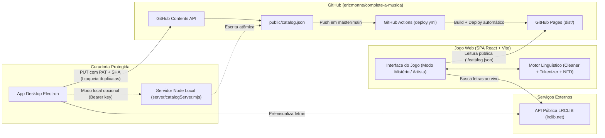

# ♪ Complete a Música

[](https://ericmonne.github.io/complete-a-musica/)
[](https://www.typescriptlang.org/)
[](https://react.dev/)
[](https://vite.dev/)
[](https://www.electronjs.org/)
[](https://vitest.dev/)

Jogo web estilo *Sporcle* / "forca" de letras musicais com **modo mistério**, preenchimento instantâneo palavra por palavra, sorteio ao vivo por artista via **LRCLIB** e um aplicativo **Desktop (Electron)** para curadoria protegida do catálogo diretamente via **GitHub Contents API** (GitOps) ou servidor Node local.

> **Jogue agora:** https://ericmonne.github.io/complete-a-musica/

---

## Funcionalidades Principais

- **Modo Mistério & Anti-Spoiler:** o jogador inicia sem saber o título da música nem o artista/banda (`???` na interface e no `document.title`). Palavras ocultas nunca são inseridas no DOM antes de serem descobertas, garantindo que inspecionar a página não revele respostas.
- **Motor Linguístico Próprio (`src/engine/`):**
  - **Normalização Unicode (`NFD`):** ignora maiúsculas/minúsculas, acentos e cedilhas (`coracao` revela `Coração`; `voce` revela `você`).
  - **Avaliação instantânea por tecla (`onChange`):** funciona inclusive para palavras de 1 ou 2 letras (`a`, `e`, `I`, `in`, `is`) e limpa a caixa de texto automaticamente apenas quando há ocorrências ainda ocultas — evitando bloquear palavras mais longas depois que o prefixo já foi descoberto.
  - **Contrações peça por peça & Pontuação visível:** pontuação (`,`, `.`, `!`, `?`, `-`, `'`) permanece visível desde o início sem precisar ser digitada. Contrações são separadas em segmentos independentes mantendo o apóstrofo visível (`"You're"` aceita `you` e `are` separadamente; `"He's"` aceita `he` e `is`; `"Don't"` aceita `do` e `not`), além de tratar gírias (`walkin'`), contrações em português (`d'água`) e compostos hifenizados (`bem-vindo`) sem aceitar homógrafos falsos (`your`, `were`, `well`, `its`).
- **Dica, Desistência Segura e Conclusão:** botão **Pedir Dica** revela apenas o artista; botão **Desistir** exige confirmação em duas etapas e destaca visualmente as palavras que faltaram; ao acertar tudo, exibe o resumo **Concluído!**.
- **Sorteio ao Vivo por Artista/Banda:** permite digitar qualquer artista ou banda para consultar a API do **LRCLIB** em tempo real, deduplicar versões de estúdio e sortear faixas sem adicioná-las ao catálogo-base.
- **Temas Claro e Escuro:** suporte automático a `prefers-color-scheme` com alternância manual persistida em `localStorage`.
- **Aplicativo Desktop de Curadoria (Electron):** interface dedicada para buscar músicas no LRCLIB (com contagem de palavras e prévia da letra limpa), cadastrar manualmente, bloquear duplicatas em tempo real e atualizar `public/catalog.json` com segurança.

---

## Arquitetura & Decisões de Engenharia

O projeto adota uma arquitetura **estática serverless (GitOps)** para produção no GitHub Pages — eliminando custos de infraestrutura de banco de dados ou backend contínuo — enquanto mantém um servidor HTTP Node nativo como alternativa local para desenvolvimento offline.



### Destaques Técnicos

- **Consistência de Deduplicação Cliente/Servidor:** a chave canônica (`canonicalSongKey` + `stripEditionSuffix`) normaliza acentos, cedilhas, pontuação e sufixos de streaming (como `- Remastered 2011`, `(Deluxe Edition)`) tanto na interface Desktop quanto na validação antes do commit e no servidor Node (`409 Conflict`).
- **GitOps Resiliente (`githubCatalogClient.ts`):** codificação Base64 segura para UTF-8 (evitando corrupção de acentos e limites de pilha do `btoa`), validação explícita de permissão de escrita do token (`permissions.push`) e *retry* automático em conflitos `409` de SHA concorrente.
- **Isolamento de Segredos:** `CATALOG_ADMIN_KEY` (modo local) e tokens PAT nunca são referenciados pelo código Web nem embutidos no bundle `dist/`.
- **Segurança no Servidor Local (`catalogServer.mjs`):** construído apenas com módulos nativos do Node (`node:http`, `node:crypto`, `node:fs/promises`), comparação de chave em tempo constante (`crypto.timingSafeEqual`), fila de escrita serializada (`writeLock`) e gravação atômica via arquivo temporário + `rename`.

### Estrutura do Projeto

```text
complete-a-musica/
├── .github/workflows/deploy.yml   # CI/CD: build Web e deploy no GitHub Pages
├── desktop/index.html             # Entrypoint HTML do renderer Electron
├── electron/
│   ├── main.cjs                   # Processo principal Electron + detecção de .env/.git
│   └── preload.cjs                # Bridge segura (contextIsolation: true)
├── public/catalog.json            # Catálogo-base oficial lido pelo jogo Web
├── scripts/
│   ├── dev.mjs                    # Sobe servidor local de catálogo + Vite Web juntos
│   └── prepare-desktop.mjs        # Prepara artefatos Electron em desktop-dist/
├── server/
│   ├── catalogServer.mjs          # API REST protegida com escrita atômica e anti-duplicata
│   ├── catalogUtils.mjs           # Normalização e chave canônica compartilhada com o servidor
│   └── index.mjs                  # Bootstrap do servidor HTTP + carregamento de .env
└── src/
    ├── components/                # Header, MysteryCard, GameControls, LyricsBoard, CompletionBanner
    ├── desktop/                   # DesktopApp + cliente GitHub Contents API
    ├── engine/                    # normalize.ts, lyricsCleaner.ts, tokenizer.ts
    ├── services/                  # lrclib.ts e catálogo inicial de fallback (seedCatalog.ts)
    └── types/game.ts              # Tipos compartilhados entre Web, Engine e Desktop
```

### Testes Automatizados

A suíte utiliza **Vitest** e **React Testing Library** cobrindo motor linguístico, regras de jogo, API Node local e integração com GitHub:

- `src/engine/__tests__/` — normalização Unicode/cedilha, limpeza de marcações LRC/colchetes e tokenização de contrações e pontuação.
- `src/components/__tests__/` — fluxo completo do jogo (`App.test.tsx`) e sorteio ao vivo por artista sem mutação do catálogo (`ArtistMode.test.tsx`).
- `src/desktop/__tests__/` — codificação UTF-8, bloqueio de token somente-leitura, retry em conflito `409` e fluxos GitHub/Local (`DesktopApp.test.tsx`, `githubCatalogClient.test.ts`).
- `src/server/__tests__/` — autenticação `401`, criação `201`, remoção `200` e rejeição `409` para duplicatas (`catalogServer.test.ts`).

---

## Como Executar Localmente

### Pré-requisitos

- **Node.js** `>= 20` (recomendado Node 22 LTS) e **npm**

### Instalação

```bash
git clone https://github.com/ericmonne/complete-a-musica.git
cd complete-a-musica
npm install
```

Para testar o modo de servidor local opcional, crie um arquivo `.env` a partir do modelo:

```bash
cp .env.example .env
```

### Scripts Disponíveis

| Comando | Descrição |
| :--- | :--- |
| `npm run dev` | Inicia simultaneamente a API local (`http://127.0.0.1:3001`) e o jogo Web (`http://127.0.0.1:5173`). |
| `npm run dev:web` | Inicia apenas o servidor Vite da aplicação Web (`127.0.0.1:5173`). |
| `npm run server` | Executa apenas o servidor HTTP de catálogo (`server/index.mjs`). |
| `npm test` | Executa toda a suíte de testes unitários e de integração (`vitest run`). |
| `npm run build` | Compila TypeScript (`tsc -b`) e gera o bundle de produção Web em `dist/`. |
| `npm run desktop:build` | Compila o app Desktop Electron em `desktop-dist/`. |
| `npm run desktop` | Compila e abre o aplicativo Desktop em modo desenvolvimento. |
| `npm run desktop:package` | Gera o executável Windows empacotado em `release/CompleteAMusica-Catalogo-win32-x64/`. |

---

## Como Colaborar

### 1. Contribuindo com Código

1. Faça um **Fork** deste repositório e crie uma branch descritiva a partir de `master`:
   ```bash
   git checkout -b feat/minha-melhoria
   ```
2. Implemente suas alterações mantendo testes para novos comportamentos.
3. Antes de abrir o Pull Request, valide que todos os testes e o build passam sem erros:
   ```bash
   npm test
   npm run build
   ```
4. Abra um **Pull Request** descrevendo claramente o problema resolvido ou a melhoria proposta.

### 2. Contribuindo com o Catálogo

#### Via Pull Request (colaboradores externos)
1. Faça um **Fork** e edite `public/catalog.json` seguindo o esquema:
   ```json
   {
     "id": "artista::musica",
     "artist": "Nome do Artista",
     "track": "Nome da Música",
     "lang": "pt",
     "tags": ["pt", "rock_pop"],
     "addedAt": "2026-11-25T00:00:00.000Z"
   }
   ```
   *(Em `tags`, utilize apenas `"pt"`, `"en"`, `"rock_pop"` e/ou `"classics"`, garantindo que a música não esteja duplicada e tenha letra válida no LRCLIB).*
2. Abra um **Pull Request** contra `master`.

#### Via App Desktop (mantenedores / curadores autorizados)
1. Gere um **Fine-grained Personal Access Token** em [github.com/settings/personal-access-tokens/new](https://github.com/settings/personal-access-tokens/new) com acesso restrito a `ericmonne/complete-a-musica` e permissão **Contents: Read and write**.
2. Abra `CompleteAMusica-Catalogo.exe` (ou execute `npm run desktop`).
3. Na aba **GitHub (GitHub Pages)**, informe `ericmonne/complete-a-musica` e o token gerado, depois clique em **Conectar / Atualizar**.
4. Pesquise músicas no LRCLIB (conferindo a contagem de palavras e prévia da letra) ou utilize o cadastro manual — duplicatas são bloqueadas automaticamente. Após salvar, o GitHub Actions republica o site em cerca de **30–45 segundos**.

---

## Licença & Créditos

- Letras buscadas sob demanda via API aberta **[LRCLIB](https://lrclib.net)**.
- Desenvolvido por **Eric Monné Fraga de Oliveira** ([@ericmonne](https://github.com/ericmonne)).
